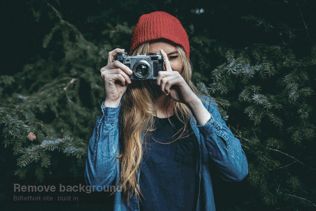

<h1>&nbsp;Prunr</h1>

Remove backgrounds, erase objects, upscale, colorize and restyle photos, all on your own computer. Free and open source, for Linux, macOS and Windows.

Website: [prunr.io](https://prunr.io/)

<p align="center">
  
</p>

## Download

| | |
|---|---|
| **Windows** (10 1903 or later) | [Installer](https://github.com/aktiwers/prunr/releases/latest/download/prunr-windows-x86_64-setup.exe) · [Portable zip](https://github.com/aktiwers/prunr/releases/latest/download/prunr-windows-x86_64.zip) |
| **macOS** (Apple Silicon, 14 Sonoma or later) | [Disk image](https://github.com/aktiwers/prunr/releases/latest/download/Prunr-macos-aarch64.dmg) · [Portable](https://github.com/aktiwers/prunr/releases/latest/download/prunr-macos-aarch64.tar.gz) · `brew install aktiwers/prunr/prunr` |
| **Linux** (x86_64) | [AppImage](https://github.com/aktiwers/prunr/releases/latest/download/Prunr-x86_64.AppImage) · [.deb](https://github.com/aktiwers/prunr/releases/latest/download/prunr-linux-x86_64.deb) · [.rpm](https://github.com/aktiwers/prunr/releases/latest/download/prunr-linux-x86_64.rpm) · [Portable](https://github.com/aktiwers/prunr/releases/latest/download/prunr-linux-x86_64.tar.gz) |

On a minimal Linux install the AppImage and tar.gz need `libgtk-3-0`, `libxkbcommon0` and `libfontconfig1`. All releases: [github.com/aktiwers/prunr/releases](https://github.com/aktiwers/prunr/releases)

## What it does

- **Remove backgrounds** in one click, then touch up with the brushes. Batch as many photos as you like.
- **Erase anything.** Paint over it, or pick it with the Magic Brush, and it's gone. Stable Diffusion can paint in something new from a prompt.
- **Magic Brush:** click or drag over anything to select it.
- **Upscale 4×** and restore faces.
- **Colorize** black-and-white photos.
- **Looks:** 17 built-in presets, depth blur, outlines and shadows for stickers, and new backgrounds. Make and share your own presets.
- **Fast on your graphics card:** CUDA, DirectML, Apple's graphics or OpenVINO, wherever each model runs fastest.
- **No cloud.** Everything runs locally, with no account and no API keys. The only connection Prunr makes on its own is a daily check for updates, so it can tell you when a new version is out. You can turn it off in Settings.

## Command line

The same `prunr` program works without a window when you give it files:

```bash
prunr photo.jpg                               # saves photo.prunr.png
prunr *.jpg -o clean/                         # a whole folder
prunr photo.jpg --preset "Red Splash"         # a built-in look
prunr photo.jpg --upscale realesrgan          # saves photo_x4.png
prunr photo.jpg --colorize                    # saves photo_color.png
prunr photo.jpg --inpaint --mask mask.png     # erase what the mask marks
```

Every option is in [docs/CLI.md](docs/CLI.md), and in the app under Help › Command-line reference.

## Models

**Built in**, so they work offline from the first start: BiRefNet-lite (cut-outs, the default), Silueta (fast cut-outs), TEED (lines), SAM 2.1 (Magic Brush), MI-GAN (eraser), Real-ESRGAN (4× upscale) and YuNet (finds faces).

**In the Model Store**, downloaded when a feature needs them: U2Net, LaMa, Big-LaMa, Stable Diffusion 1.5, RORem, Nomos2, Nomos8k, Siax, Superscale, Real-ESRGAN 2×, DDColor, GFPGAN, RestoreFormer++ and Depth Anything V2.

## Graphics cards

Prunr runs each model wherever it's fastest on your computer: DirectML on Windows and Apple's graphics on the Mac (built in), CUDA for NVIDIA cards and OpenVINO for Intel (add-ons in Settings › Hardware), MIGraphX for AMD on Linux, and the processor otherwise. `prunr --doctor` shows what it found; `prunr bench` times every model.

## Build from source

The toolchain installs itself through rustup; on Linux you also need the GTK3 development libraries.

```bash
cargo xtask fetch-models            # one-time download of the models
cargo run --release -p prunr-app    # build and start the app
```

The app loads ONNX Runtime when it starts: from `ORT_DYLIB_PATH`, from the runtime store (Settings › Hardware), or from a `runtime/` folder next to the program, as the downloads ship it.

## License

Apache-2.0, see [LICENSE](LICENSE).
