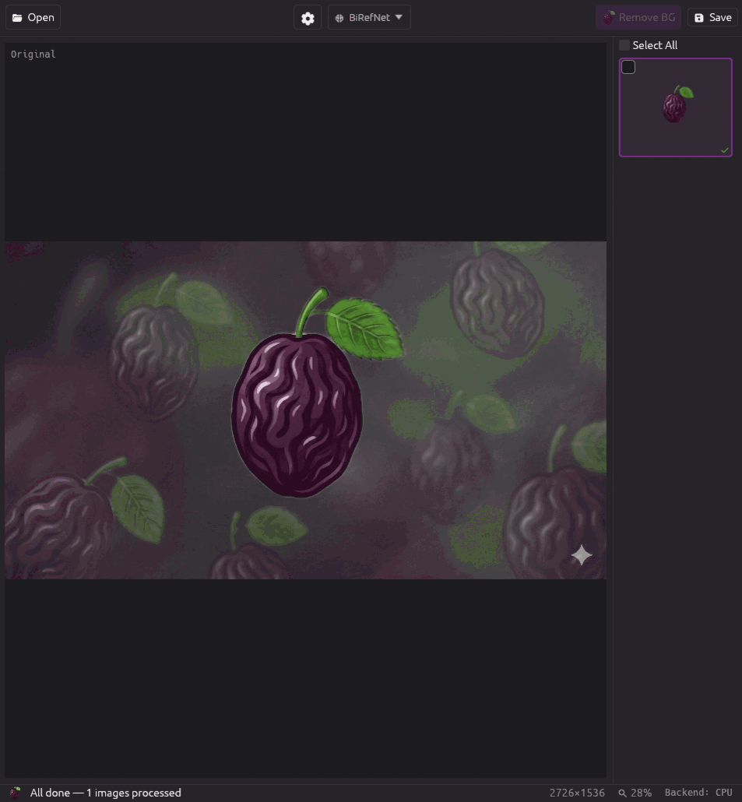

<h1>&nbsp;Prunr</h1>

Local AI background removal. One binary, no cloud, no API keys.

Prunr removes backgrounds from images using ONNX neural networks running entirely on your machine. Ships as a single binary with embedded models — download, run, done. GUI and CLI in the same executable.

Website: [prunr.io](https://prunr.io/)

<p align="center">
  
</p>

## Download

### Linux (x86_64)

| Format | Link |
|--------|------|
| AppImage (any distro) | [Prunr-x86_64.AppImage](https://github.com/aktiwers/prunr/releases/latest/download/Prunr-x86_64.AppImage) |
| Debian / Ubuntu | [.deb](https://github.com/aktiwers/prunr/releases/latest/download/prunr-linux-x86_64.deb) |
| Fedora / RHEL / openSUSE | [.rpm](https://github.com/aktiwers/prunr/releases/latest/download/prunr-linux-x86_64.rpm) |
| Portable | [tar.gz](https://github.com/aktiwers/prunr/releases/latest/download/prunr-linux-x86_64.tar.gz) |

The .deb / .rpm packages declare their runtime deps. If you use the
AppImage or tar.gz on a minimal install and hit a missing-library error,
install: `libgtk-3-0`, `libxkbcommon0`, `libfontconfig1`. Already present
on Ubuntu 22.04+ / Fedora 40+ / openSUSE Tumbleweed.

### macOS (Apple Silicon, macOS 14 Sonoma or later)

| Format | Link |
|--------|------|
| Disk image | [Prunr-macos-aarch64.dmg](https://github.com/aktiwers/prunr/releases/latest/download/Prunr-macos-aarch64.dmg) |
| Homebrew | `brew install aktiwers/prunr/prunr` |
| Portable | [tar.gz](https://github.com/aktiwers/prunr/releases/latest/download/prunr-macos-aarch64.tar.gz) |

### Windows (x86_64)

| Format | Link |
|--------|------|
| Installer | [prunr-windows-x86_64-setup.exe](https://github.com/aktiwers/prunr/releases/latest/download/prunr-windows-x86_64-setup.exe) |
| Portable | [zip](https://github.com/aktiwers/prunr/releases/latest/download/prunr-windows-x86_64.zip) |

GPU acceleration is built in: both downloads ship Microsoft's Windows ML build of ONNX Runtime (1.30, with DirectML), which runs the models on any DirectX 12 graphics card (NVIDIA, AMD, Intel) and on the processor when there is none. With an NVIDIA card, Prunr offers CUDA on first launch (about 2 GB with NVIDIA's libraries). It runs beside DirectML: each model uses whichever is faster for it, and CUDA runs the few models DirectML cannot. Windows 10 1903 or later.

All releases: [github.com/aktiwers/prunr/releases](https://github.com/aktiwers/prunr/releases)

## Features

- **Four bundled models** — Silueta (fast), BiRefNet-lite (best detail at 1024×1024), TEED (lines), SAM 2.1 (Magic Brush)
- **Magic Brush** — click or drag over anything and SAM 2.1 selects it; Shift adds, Alt subtracts. Then Delete, Copy, Cut or Invert the selection, or let it correct the cut-out
- **Paint Brush** — manual touch-ups with size, hardness, opacity and shape; every stroke is undoable
- **Line extraction** — edges/outlines via TEED at three scales, standalone or combined with background removal, with colour styles and compositions
- **Eraser** — paint over an unwanted area and let LaMa, Big-LaMa, MI-GAN, Stable Diffusion 1.5 (with prompts) or RORem (large objects) fill it in; the footer shows how large the fill ran, Try another re-rolls a generated fill
- **Upscale** — Real-ESRGAN, NMKD, HAT and RealPLKSR models at 2×, 3× or 4×, with denoise, sharpen, AI blend, saturation and colour match
- **Colorize** — DDColor colours a black-and-white photo; Strength up to 150 % re-renders live
- **Restore faces** — GFPGAN or RestoreFormer++ redraw soft, small or compressed faces on cut-outs, upscales and plain photos, blended by strength
- **Custom backgrounds** — fill the cutout with a solid colour, a picked image (cover / contain / tile) or a blurred, lens-blurred or black-and-white version of the photo
- **Depth effects** — Depth Anything V2 measures how near each part of the photo is: lens blur and tilt-shift, fog, aerial perspective, lines that fade with distance, select by depth, and 16-bit depth map export
- **Hardware acceleration** — CUDA (NVIDIA), CoreML (Apple), DirectML (Windows), OpenVINO (Intel processors and graphics), automatic CPU fallback
- **Batch processing** — tick images and Process runs any model on each: cut-outs in parallel, upscales, colorize and erasers one after the other; switch between images while they work, chain background removal into lines or upscale
- **Mask tuning** — removal strength, hard cutoff, edge shift, feather, guided filter for fine detail, all previewed live
- **Presets and undo** — per-model presets, Compare toggle, undo across strokes, results and presets
- **Drag-and-drop** — in and out of the window (drop into Finder/Explorer/Word/PowerPoint)
- **No cloud** — everything runs locally, no telemetry, no API keys. Prunr sends nothing. One exception on Windows: DirectML, Microsoft's graphics-card library that comes with Prunr, can add which of your graphics card's features it could use to Windows' own diagnostic reports. Windows sends those only when **Send optional diagnostic data** is on (Settings › Privacy & security › Diagnostics & feedback); DirectML has no switch of its own.

## CLI

The binary runs headless when given image arguments:

```bash
prunr photo.jpg                              # saves photo.prunr.png
prunr *.jpg -o clean/                        # batch to a folder
prunr -m u2net portrait.jpg                  # quality model
prunr -j 4 *.jpg -o out/                     # 4 parallel jobs
prunr --lines logo.png                       # line extraction only
prunr --inpaint photo.jpg --mask m.png       # erase area defined by mask
prunr photo.jpg --bg-image studio.jpg        # bake a chosen image as the new background
```

Common flags:

| Flag | Description |
|------|-------------|
| `-o, --output <PATH>` | Output file or directory |
| `-m, --model <MODEL>` | `birefnet-lite` (default), `silueta`, `u2net` |
| `-j, --jobs <N>` | Images at once (default: as the app: half the cores, 2 on a graphics card, fewer when memory is short) |
| `-f, --force` | Overwrite existing output |
| `--cpu` | Force CPU inference |
| `--gamma <N>` | Removal strength (default: 1.0) |
| `--contrast <N>` | Edge contrast (0.0–1.0); 1 is a hard edge |
| `--edge-shift <N>` | Grow (positive) or shrink (negative) the cut-out by N pixels |
| `--edge-width <N>` | How far `--refine-edges` looks from the edge, in pixels (default 8) |
| `--feather <N>` | Soften the edge by N pixels; fractions allowed |
| `--refine-edges` | Guided filter for fine detail (hair, leaves) |
| `--lines` | Extract lines/edges only |
| `--lines-after-bg` | Remove the background, then draw lines on the result |
| `--line-detail <N>` | How much detail becomes lines, 0.0–1.0 (default 0.5); `--line-strength` still works |
| `--line-width <N>` | Line width in pixels, 0–20 |
| `--line-composition <M>` | With `--lines-after-bg`: `lines-only`, `subject-filled`, `engraving`, `ghost` |
| `--line-scale <S>` | `fine`, `bold`, `fused` (default) |
| `--line-color <HEX>` | Paint all lines one colour |
| `--large-image <P>` | Images above 8000 px: `process` (default, keep the original size) or `downscale` (to 4096 px) |
| `--bg-color <HEX>` | Fill transparent background with a colour (e.g. `ffffff`) |
| `--bg-image <PATH>` | Fill transparent background with a chosen image (wins over `--bg-color`) |
| `--bg-image-fit <MODE>` | `cover` (default), `contain`, `stretch`, `tile`, `center` |
| `--inpaint --mask <PATH>` | Eraser mode — fill a masked region using LaMa |
| `--fill-scale <S>` | Eraser: `auto` (default), `full`, `half`, `quarter` — large areas fill more convincingly smaller |
| `--upscale <MODEL>` | Upscale mode: `realesrgan`, `nomos`, `nomos2`, `siax`, `superscale`; saves `{stem}_x{scale}.png` |
| `--scale <2\|3\|4>` | Upscale: how much larger (default 4) |
| `--denoise`, `--sharpen`, `--ai-blend`, `--color-match` | Upscale: the Refine knobs |
| `--restore-faces <MODEL>`, `--face-strength <0-100>` | Redraw soft faces with `gfpgan` or `restoreformer` |
| `--colorize`, `--color-strength <0-1.5>` | Colorize mode: colour a black-and-white photo with DDColor; saves `{stem}_color.png` |
| `--bg-effect lens[:N]` | Lens-blur the photo behind the subject, 0–100 (needs the depth model) |
| `--line-fade <0-100>` | Lines lighten with distance (needs the depth model) |
| `--depth-map`, `--depth-only` | Also write `{stem}-depth.png` (16-bit, white = near); with `--depth-only`, only that |
| `--open <PATH>` | Start the GUI with an image already loaded |
| `--debug` | Verbose diagnostics for bug reports |
| `--doctor` | Diagnostic dump for support tickets (hardware, ORT, models, paths) |
| `--clear-ep-cache` | Wipe persistent EP failure cache (after driver/runtime updates) |
| `bench` | Time every installed model on the CPU and on the GPU path, compare their outputs, write `prunr-bench.md` + `.json`; `--models a,b`, `--runs N`, `--image PATH`, `--heavy`, `--out PATH` |

`prunr --help` for the full list. Magic Brush and the generative erasers are GUI features; the CLI covers background removal, lines, mask-driven erasing with LaMa, upscaling, colorizing and depth maps. On-demand models download in the app's Model Store.

## Models

| Model | Size | Bundled? | Resolution | Best for |
|-------|------|---------|-----------|----------|
| BiRefNet-lite | ~214 MB | yes | 1024×1024 | Fine detail (hair, leaves) — **default** |
| Silueta | ~4 MB | yes | 320×320 | Fast, clean subjects |
| TEED | ~0.25 MB | yes | 640×480 and 1280×960 | Line / edge extraction |
| SAM 2.1 Hiera Small | encoder + decoder | yes | 1024 input | Magic Brush selections |
| U2Net | ~170 MB | **on-demand** | 320×320 | Better edges than Silueta |
| LaMa (Eraser) | ~199 MB | **on-demand** | 512×512 (tiled) | Object removal — paint over a region, fill it in |
| Big-LaMa (Eraser) | ~199 MB | **on-demand** | 512×512 (tiled) | Sharper fills than LaMa, same architecture trained on more data |
| MI-GAN (Eraser) | ~26 MB | **on-demand** | 512×512 (tiled) | Lightweight GAN — sharper detail, less smooth on flat backgrounds |
| Stable Diffusion 1.5 Inpaint | ~2 GB | **on-demand** | 512×512 (tiled) | Generative inpaint with prompts — phone-app-class quality. **GPU strongly recommended.** |
| SD 1.5 LCM Inpaint | ~2 GB | **on-demand** | 512×512 (tiled) | Same, distilled to converge in 4–8 steps — the Fast quality preset |
| TAESD | ~2.6 MB | **on-demand** | — | Fast VAE decoder for the SD erasers (about 3× faster decode) |
| RORem (Eraser) | ~5.1 GB | **on-demand** | 512×512 (crop or tiled) | Removes large objects and fills with background, never with something new (SDXL, 4 steps). Needs ~15 GB of free RAM |
| Real-ESRGAN x4plus / x2plus | see Model Store | **on-demand** | tiled | Upscale photos; x2plus also powers the 4× two-pass look |
| 4x NMKD Siax-CX / Superscale | see Model Store | **on-demand** | tiled | Upscale with a sharper, more textured character |
| 4xNomos8kSCHAT-L | see Model Store | **on-demand** | tiled | Transformer upscale for the finest detail; slowest |
| 4xNomos2 RealPLKSR | ~31 MB | **on-demand** | whole image, in parts | Fast upscale with natural skin and hair texture; can crackle on flat snow. Short of memory, it keeps its in-between results at half precision (within 1/255) |
| DDColor | ~270 MB | **on-demand** | 512×512 | Colorize black-and-white photos |
| GFPGAN v1.4 / RestoreFormer++ | ~340 / ~295 MB | **on-demand** | 512×512 per face | Restore faces: the crispest / closest to the person's own features |
| Depth Anything V2 Small | ~95 MB | **on-demand** | 518 short side | Depth effects: lens blur, fog, aerial perspective, line fade, select by depth, depth maps |

The default install bundles Silueta + BiRefNet-lite + TEED + SAM 2.1 for the common cases. Everything else is a download from prunr's GitHub releases: wherever a feature needs a model that isn't installed, the app says **Get <model> · <size>** and opens the Model Store on it. The Model picker lists every model, downloaded or not; **Get more models** opens the Store, where you can browse, download, view progress, retry, and delete installed models. SHA256 is verified after every download; partial files clean up automatically on cancel.

## Hardware Acceleration

Prunr picks the best available backend automatically per-model. Backends bundled or installed on-demand:

| Backend | Hardware | Bundled? | Notes |
|---|---|---|---|
| CUDA | NVIDIA GPU | on-demand (Linux, Windows) | Settings → Hardware → Install (about 2 GB with NVIDIA's CUDA and cuDNN libraries); offered on first launch with an NVIDIA card. On Windows it joins the built-in DirectML, and each model runs on the faster |
| CoreML | Apple Silicon | yes (macOS) | Neural Engine + GPU |
| DirectML | Any DirectX 12 GPU on Windows | yes (Windows) | Built into the Windows download (the Windows ML build of ONNX Runtime 1.30); falls back to the CPU without a GPU |
| **OpenVINO** | **Intel CPU / graphics** | **on-demand (Linux, Windows)** | Settings → Hardware → Install (50 MB on Linux, 76 MB on Windows); joins Prunr's own runtime, beside DirectML and CUDA |
| CPU | Always | yes (everywhere) | Automatic fallback |

**OpenVINO is the win for Intel computers without an NVIDIA card.** On an i5-11600KF it ran the upscalers 1.5 times and Depth twice as fast as Prunr's own processor engine, with the same pictures, and it can try Intel graphics (Settings → Hardware). The first launch on Intel hardware offers it; you can also install it later from Settings → Hardware. It lives in Prunr's runtime folder (`~/.local/share/prunr/runtimes/` on Linux) and takes about 150 MB of disk on Linux, 120 MB on Windows.

**Where each model runs** is declared in the model registry (`places` field): per accelerator, on it or on the CPU and why. A model that doesn't load on a specific EP — e.g. Big-LaMa, whose graph OpenVINO's converter rejects — skips that EP entirely instead of paying a failed-load cost. User-specific failures (driver bugs, etc.) are also auto-cached at `~/.local/share/prunr/ep_compat.json` and persist across runs until the graphics driver, the runtime or an add-on changes; `prunr --clear-ep-cache` wipes them.

The active backend is shown in the status bar. For diagnostics, run `prunr --doctor` to dump the full hardware profile, runtime status, model availability, and resolution chain — pasteable directly into bug reports.

To check acceleration model by model, run `prunr bench`. Each installed model runs on the CPU and through the backend the app would pick; the report names the backend each one landed on (and why another was passed over), times the session build, first run and steady runs, and flags a model whose GPU output differs from the CPU's, with which of the two looks right and both pictures saved in `prunr-bench-outputs/`.

## Build from Source

The pinned toolchain (`rust-toolchain.toml`) installs itself through rustup; on Linux you also need the GTK3 development libraries.

```bash
cargo xtask fetch-models                          # one-time model download, ~174 MB
cargo build --release -p prunr-app                # release binary
cargo run --release -p prunr-app                  # build + run GUI

# Diagnostic
target/release/prunr --doctor                     # hardware + runtime status dump
target/release/prunr --clear-ep-cache             # reset EP compatibility cache
target/release/prunr bench                        # CPU vs GPU path, per model
```

The app uses `ort` with `load-dynamic` — the ONNX Runtime shared library is resolved at startup from (in order):

1. `ORT_DYLIB_PATH` env var (developer override)
2. User Runtime Store: `~/.local/share/prunr/runtimes/<id>/libonnxruntime.so`
3. Bundled fallback: `<exe>/runtime/libonnxruntime.so`

Every artifact ships an ORT in (3) so the app works on a clean machine. CI stages Microsoft's PyPI wheel via `cargo xtask install-runtime onnxruntime[-windowsml] <ver> --stage-to <dir>` — the same code path the GUI uses for the runtime store, so installer layout and "Settings → Hardware → Install runtime" can't drift. Linux artifacts (tar.gz / AppImage / .deb / .rpm) get the CPU-only runtime in `<exe>/runtime/`; Windows artifacts (.zip / installer) the Windows ML build (`onnxruntime.dll` + `DirectML.dll`); installing a store runtime makes it the one Prunr loads, and Settings › Hardware › Runtime switches between them; the macOS arm64 wheel carries **CoreML** and goes into `Prunr.app/Contents/Frameworks/` (next to the binary in the tar.gz). The CUDA and OpenVINO add-ons, which join the runtime Prunr ships, and the MIGraphX runtime install via Settings → Hardware.

See [ARCHITECTURE.md](ARCHITECTURE.md) for internals.

## License

Apache-2.0 — see [LICENSE](LICENSE).
